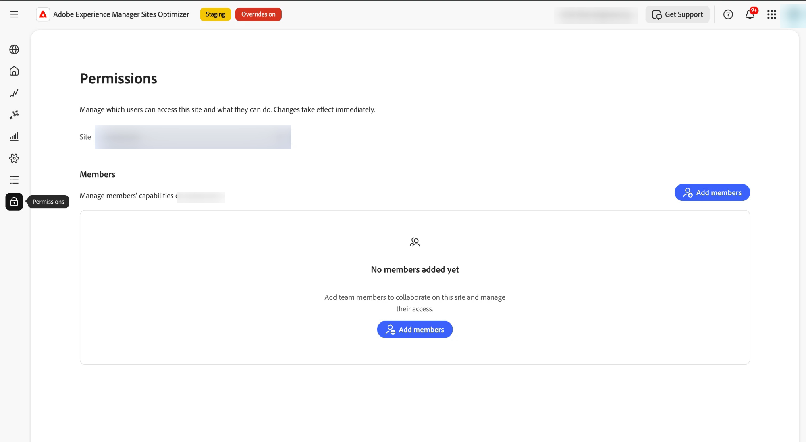
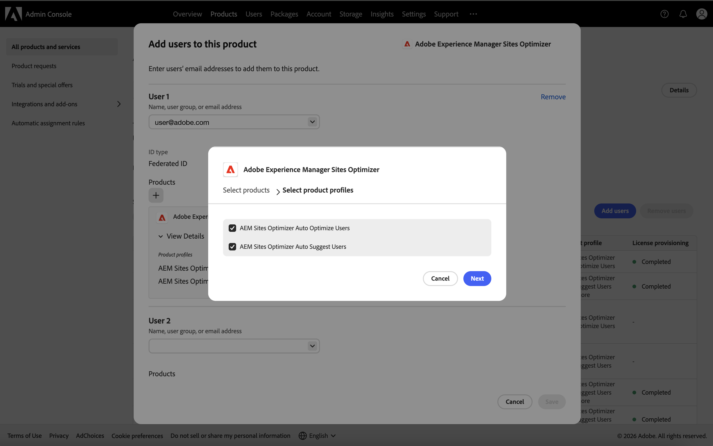
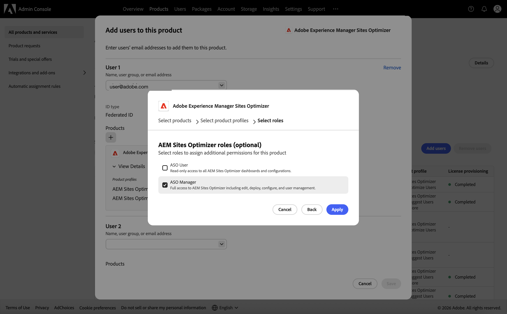
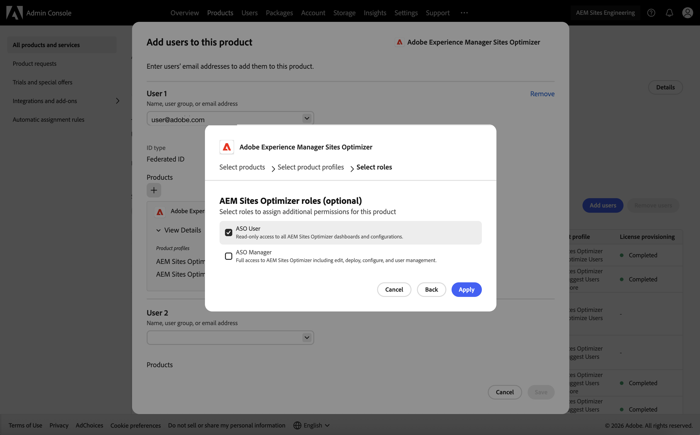

# Administrar permisos de usuario

Controle quién puede acceder a un sitio en Sites Optimizer y qué puede hacer con él. El acceso se genera a partir de un pequeño conjunto de *capacidades* independientes (ver, editar, implementar, configurar y administrar usuarios) que usted concede a personas individuales o a grupos de usuarios.

El acceso es **aditivo**: los permisos de una persona son la suma de todo lo que se le ha concedido. No hay &quot;denegar&quot;, así que las concesiones nunca entran en conflicto ni se cancelan mutuamente. Para que alguien tenga menos acceso, quite una concesión en lugar de intentar anularla.

Para administrar el acceso, abra la ficha **Permisos** (el icono de candado en el panel de navegación izquierdo) y, a continuación, seleccione el sitio que desee administrar.

{align="center"}

## Cómo se concede el acceso

Hay dos maneras en que una persona puede obtener acceso y trabajan juntas:

- **Acceso en toda la organización** — asignado por el administrador de organización de Adobe en [Adobe Admin Console](https://adminconsole.adobe.com/). Se aplica a todos los sitios de su organización. Utilícelo para personas que necesitan el mismo acceso en todas partes.
- **Acceso de nivel de sitio** — asignado dentro de Sites Optimizer, en la ficha **Permisos**. Se aplica a un solo sitio y puede ser tan amplio o estrecho como necesite. No se requiere acceso a Admin Console.

>[!NOTE]
>
>Las dos capas se suman. Alguien con acceso de visualización en toda la organización y a quien también se le conceda Editar en un sitio, puede ver todos los sitios y editar ese sitio. Para mantener a una persona limitada a un solo sitio, asegúrese de que no tenga también una función para toda la organización.

### Funciones en toda la organización (Admin Console)

El acceso para toda la organización proviene de una de las dos funciones de producto de **AEM Sites Optimizer**, asignadas en [Adobe Admin Console](https://adminconsole.adobe.com/):

- **Administrador de ASO**: acceso completo a todos los sitios, incluidos **Administrar usuarios**. Un administrador puede abrir la ficha **Permisos** de cualquier sitio y asignar acceso a otros.
- **Usuario ASO**: acceso de solo vista a cada sitio. Sin cambios ni administración de usuarios.

Para asignar una función, debes ser **administrador del sistema** para la organización o **administrador de productos** para AEM Sites Optimizer.

1. Inicie sesión en [Adobe Admin Console](https://adminconsole.adobe.com/).
1. Vaya a **Productos** y seleccione **AEM Sites Optimizer**.
1. Abra la ficha **Usuarios** y agregue el usuario por correo electrónico (o seleccione un usuario existente).
1. Haga clic en el icono **+** (agregar) para agregar un perfil de producto y, a continuación, elija el perfil de producto.

   {align="center"}

1. Haga clic en **Siguiente**.
1. Elija la función **Administrador de ASO** para obtener acceso completo o **Usuario de ASO** para obtener acceso de solo vista y, a continuación, haga clic en **Aplicar**.

   {align="center"}

   {align="center"}

Para obtener más información sobre cómo agregar usuarios, consulte [Usuarios incorporados](setup/onboard-users.md).

>[!IMPORTANT]
>
>Solamente un administrador de organización puede otorgar **Administrar usuarios** en toda la organización. Un miembro que tenga **Administrar usuarios** en un sitio puede asignar acceso a ese sitio, pero no puede crear un **Administrador de ASO** para toda la organización.

## Niveles de capacidad

Cada capacidad controla un tipo de acción. Son independientes; por ejemplo, se puede conceder la opción Implementar sin Editar.

| Capacidad | Lo que permite | Lo que no permite |
|---|---|---|
| Ver | Vea los datos del sitio (oportunidades, sugerencias, correcciones, informes y configuración) sin cambiar nada. | Cualquier cambio. |
| Editar | Cree y cambie oportunidades y sugerencias (qué debería cambiar). | Publicar cambios, cambiar la configuración o administrar usuarios. |
| Implementación | Publique las correcciones en directo en el sitio y deshágalas. | Administración de usuarios. |
| Configuración | Cambie la configuración y las conexiones del sitio. | Publicar correcciones o administrar usuarios. |
| Administrar usuarios | Conceder o revocar el acceso de otros miembros al sitio. | Administración de un sitio al que la persona no tiene acceso. |

>[!NOTE]
>
>**Vista siempre está incluida.** Cada concesión incluye Ver automáticamente: no puede administrar, configurar, editar ni implementar algo que no puede ver. Debido a esto, la vista no se puede eliminar por sí sola. Para quitar el acceso de alguien por completo, quita el miembro (consulta [Editar o quitar un miembro](#edit-or-remove-a-member) a continuación) en lugar de desmarcar todas las capacidades.

## Acceso del ámbito a los tipos de oportunidad

En un solo sitio, puede conceder Ver, Editar e Implementar para **tipos de oportunidades específicas** (por ejemplo, Core Web Vitals o vínculos internos rotos) en lugar de todo el sitio. Esto permite que una persona edite Core Web Vitals mientras solo ve todo lo demás.

- **Ver**, **Editar** y **Implementar** se pueden vincular a uno o más tipos de oportunidad o a **Todos**.
- **Configurar** y **Administrar usuarios** siempre se aplican a todo el sitio; no se pueden limitar a un tipo de oportunidad.

Cada concesión con ámbito aparece como su propia fila para el miembro, con una columna **Se aplica a** que muestra el tipo de oportunidad, **Todos** o **En todo el sitio**.

>[!CAUTION]
>
>El ámbito solo limita lo que proporciona *esa concesión de*; nunca elimina el acceso que proporciona otra concesión. Si una persona también tiene acceso en toda la organización o una concesión de tipo **All**, se seguirá aplicando ese acceso más amplio. Por lo tanto, para limitar a alguien a tipos de oportunidades específicos, asegúrese de que no tenga una función más amplia o una concesión de **Todos**.

## Concesión de acceso a grupos de usuarios

Además de las personas individuales, puedes conceder acceso a nivel de sitio a un **grupo de usuarios** desde el [Adobe Admin Console](https://adminconsole.adobe.com/) de tu organización. Todos los miembros del grupo obtienen las capacidades que concede al grupo en ese sitio, de modo que puede administrar el acceso de todo un equipo con una única concesión.

- Los grupos de usuarios se crean y mantienen en Admin Console, en **Usuarios** > **Grupos de usuarios**. Sites Optimizer enumera los grupos que ya existen en su organización. No puede crear un grupo desde la ficha **Permisos**.
- Cuando las personas se unen al grupo o lo abandonan en Admin Console, su acceso al sitio cambia con él. No es necesario actualizar nada en Sites Optimizer.
- A un grupo se le otorgan capacidades y tipos de oportunidad exactamente igual que a una persona, y aparece en la tabla **Miembros** con la etiqueta **Grupo**. Puede editarlo o eliminarlo del mismo modo.
- El acceso grupal se suma a todo lo demás que posee una persona. Una persona que pertenece a un grupo y también tiene su propia subvención obtiene la combinación de ambos.

>[!NOTE]
>
>Si no se puede cargar el nombre de un grupo, su fila de la tabla **Members** muestra un Id. de grupo abreviado en su lugar. Pase el ratón sobre el ID o céntrese en él para verlo todo. La subvención sigue siendo válida.

## Agregar un miembro

Un miembro es una persona o un grupo de usuarios.

1. Abra la ficha **Permisos** (el icono de candado en el panel de navegación izquierdo) y seleccione el sitio.
1. Haga clic en **Agregar miembros**.
1. En **Personas y grupos**, busque personas por nombre o correo electrónico, o grupos de usuarios por nombre. Seleccionar una o más personas o grupos: los grupos se marcan con la etiqueta **Grupo**.
1. Elija **los tipos de oportunidad** a los que se aplica el acceso (o **Todos**) y, a continuación, seleccione las capacidades que desea conceder.
1. Haga clic en **Agregar**.

## Editar o quitar un miembro

En la tabla **Members**:

- Haga clic en **Editar capacidades** en la fila de un miembro para cambiar lo que puede hacer. Al editar una concesión existente, su tipo de oportunidad permanece fijo: sólo cambia las capacidades y debe permanecer seleccionada al menos una.
- Haga clic en **Quitar** para revocar por completo el acceso de ese miembro al sitio.

Una persona que ya no forma parte de su organización (por ejemplo, alguien que se fue) aparece en la tabla **Miembros** con la etiqueta **Usuario inactivo** y su ID en lugar de un nombre. No puede editar su acceso, pero puede eliminar el miembro para limpiar la entrada.

>[!NOTE]
>
>Cambiar las capacidades y quitar un miembro son acciones diferentes. Para quitar todo acceso, use **Quitar**; no puede hacerlo desmarcando las capacidades, porque una concesión debe conservar al menos una capacidad (y Ver siempre permanece).

## Quién puede administrar permisos

La ficha **Permisos** de un sitio está disponible para:

- Miembros con la capacidad **Administrar usuarios** en ese sitio y
- Administradores de organización (un administrador de ASO).

Los miembros sin **Administrar usuarios** ven un mensaje que indica que no tienen permiso para administrar el acceso a ese sitio.

## Activar la administración de usuarios y acceso

La administración de usuarios y accesos está controlada por una configuración para su organización. Puede asignar el acceso antes de activarlo, pero solo se **aplicará** una vez activado el ajuste.

Si aún no está habilitada, la ficha **Permisos** muestra un banner en el que se le pide que se ponga en contacto con el equipo de la cuenta. Póngase en contacto con el equipo de su cuenta de Sites Optimizer para activarla.

>[!NOTE]
>
>Hasta que se active la administración de usuarios y acceso, los permisos que asigne se guardarán, pero no se aplicarán.

## Configuración del acceso antes de la aplicación

No tiene que esperar a que la aplicación empiece a asignar acceso. Aunque la administración de usuarios y acceso siga estando **desactivada**, los usuarios con el rol **Administrador de ASO** pueden abrir la ficha **Permisos** y asignar sitios y capacidades a otros usuarios.

Esto le permite preparar el acceso adecuado para todos por adelantado. Cuando se activa la aplicación más adelante, los usuarios ya tienen el acceso que necesitan, por lo que nadie queda bloqueado de forma inesperada.

>[!IMPORTANT]
>
>Mientras la aplicación esté desactivada, la ficha **Permisos** solo está disponible para los usuarios de **ASO Manager**. Configure primero el acceso para todos los usuarios y, a continuación, active la aplicación.

## Preguntas frecuentes

**¿Necesitan los miembros de nivel de sitio un rol de Admin Console?**

No. El acceso de nivel de sitio se concede completamente dentro de Sites Optimizer, en la ficha **Permisos**. En Admin Console solo se asignan funciones para toda la organización.

**¿Qué sucede si alguien tiene acceso a nivel de sitio y a nivel de toda la organización?**

Ambos se aplican. Su acceso efectivo es la combinación de ambos. Las concesiones nunca entran en conflicto, ya que ninguna concesión puede denegar el acceso.

**¿Por qué un miembro con la función Administrar usuarios no puede crear un administrador para toda la organización?**

La creación de una función para toda la organización es una acción de Admin Console. Un miembro con **Administrar usuarios** puede asignar acceso a su propio sitio, pero solamente un administrador de la organización puede otorgar roles en toda la organización.

**¿Cómo revoco el acceso de una persona a un sitio?**

Quite su concesión en la ficha **Permisos**. Esto es diferente a las capacidades de edición, que siempre deben dejar al menos una capacidad.

**¿Puedo conceder acceso a todo un equipo a la vez?**

Sí. Agregue un grupo de usuarios de Admin Console como miembro en la ficha **Permisos**. Todos los miembros del grupo obtienen las capacidades del grupo en ese sitio y el acceso sigue la pertenencia del grupo a Admin Console. Consulte [Conceder acceso a grupos de usuarios](#grant-access-to-user-groups).

**¿Puedo limitar a una persona a tipos de oportunidades específicos?**

Sí — conceder vista, edición o implementación con ámbito a tipos de oportunidad específicos en lugar de **Todos**. Como el acceso es aditivo, esto solo tiene efecto si la persona no tiene también acceso en toda la organización o una concesión de tipo **All**.
