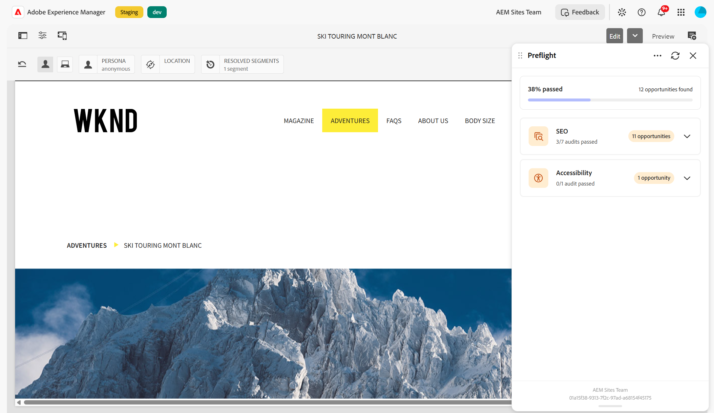
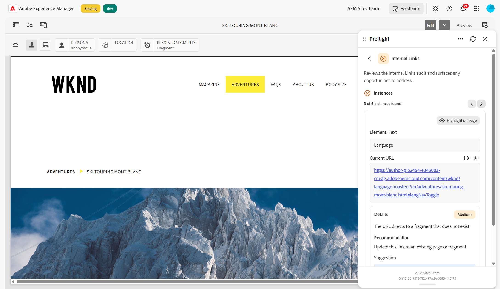

# Resultados de la auditoría en Preflight

Cuando se completan las auditorías, la comprobación preliminar muestra sus resultados en el panel de resultados. El panel muestra un medidor de resultados general y las oportunidades que encontró, agrupadas por categoría de auditoría. Dentro de cada categoría, las auditorías individuales identifican elementos específicos que se deben revisar o corregir.

## Barra de herramientas

La barra de herramientas situada en la parte superior del panel de resultados proporciona acciones para la ejecución actual:

* **Volver a analizar**: inicia una nueva ejecución de auditoría en la página actual. Volver a analizar siempre descarta los resultados mostrados y ejecuta cada auditoría de nuevo, por lo que debe utilizarlo siempre que desee resultados nuevos; por ejemplo, después de editar la página. Seleccione **Volver a analizar** en la barra de herramientas.
* **Exportar** - Descargue la ejecución actual como un archivo **CSV** (compatible con la hoja de cálculo) o **PDF** (un documento con formato). Según el entorno, seleccione **Exportar** en la barra de herramientas o en **Más acciones** (**...**) menú.
* **Configuración** - Usa **Mostrar vínculos de navegación del sitio** para incluir vínculos de navegación del sitio (actualmente solo vínculos internos). Seleccione el icono del engranaje o abra **Más acciones** (**...**) y seleccione **Configuración**. La configuración está disponible antes o después de que finalice una ejecución, pero no mientras se están ejecutando auditorías o en el Editor universal. Ver [Incluir vínculos de navegación del sitio](./opportunities/seo/internal-links.md#include-site-navigation-links).

Si cambia una configuración después de una ejecución, un punto en **Volver a analizar** y la etiqueta **Volver a analizar para aplicar la nueva configuración** indican que los resultados mostrados usaron una configuración diferente. Seleccione **Volver a analizar** para aplicar la configuración guardada a una nueva ejecución.

Al exportar, también puede elegir qué incluir:

* **Incluir tabla de metadatos**: agregue una tabla de detalles de ejecución, como el host, la ruta de contenido y los detalles de generación.
* **Incluir auditorías aprobadas**: incluya las auditorías que se aprobaron sin oportunidades, no solo las oportunidades que se encontraron.

Las auditorías que no se pudieron completar siempre se incluyen, independientemente de lo que elija. Para obtener más información, consulte [Auditorías que no se pudieron completar](#audits-that-could-not-be-completed).

>[!NOTE]
>
>Las exportaciones de PDF siempre se generan en inglés, independientemente del idioma de la interfaz. Las exportaciones de CSV siguen el idioma de la interfaz lo más fielmente posible.

## Medidor de resultados

En la parte superior del panel, el medidor de resultados refleja los resultados generales de la auditoría. Muestra el porcentaje de auditorías que finalizaron sin oportunidades, con la etiqueta **% superado**, junto con el número total de oportunidades encontradas en todas las auditorías. Por ejemplo, **el 85% superó** significa que el 85% de las auditorías completadas no encontraron oportunidades. Este porcentaje describe los resultados de la auditoría, no el progreso durante la ejecución.

{align="center"}

Cuando está viendo una ejecución que se recargó desde una sesión anterior, el encabezado muestra hace cuánto tiempo se realizó, por ejemplo, *ayer*. Para obtener más información, vea [Continuar una sesión anterior](./audits.md#continue-a-previous-session).

Mientras se siguen ejecutando las auditorías, el panel muestra **Analizando página** con un estado corto debajo. Al principio aparece una barra de progreso, antes de que lleguen las categorías de auditoría con nombre. Después, aparece un indicador de procesamiento solo junto a cada auditoría que se sigue ejecutando, no en su categoría. Cuando se completan todas las auditorías, el medidor muestra el porcentaje final aprobado y el recuento de oportunidades.

## Categorías de auditoría

Los grupos de comprobaciones relacionaron auditorías en categorías como **SEO** y **Accesibilidad**. Cada categoría aparece como una tarjeta que muestra el número de oportunidades encontradas o indica que todas sus auditorías pasaron sin oportunidades.

Expanda una categoría para ver sus auditorías individuales. Cada auditoría muestra si se aprobaron o encontraron oportunidades, una breve descripción y un recuento de las oportunidades encontradas. Seleccione una auditoría que haya encontrado oportunidades para abrir su página de detalles.

Una categoría puede mostrar resultados mientras se siguen ejecutando algunas de sus auditorías. Su estado indica, por ejemplo, **3/3 auditorías realizadas hasta el momento**. Este recuento incluye solo las auditorías que han devuelto resultados, de modo que puede cambiar a medida que llegan más resultados. Expanda la categoría para ver qué auditorías se siguen ejecutando. Una categoría sin oportunidades muestra su marca de verificación de borrado solo después de que finalice su trabajo pendiente.

### Auditorías que no se han podido completar

En ocasiones no se puede completar una auditoría para una página, por ejemplo porque la comprobación no pudo evaluar la página o se produjo un error. La comprobación preliminar no muestra una auditoría como la que se ha realizado. En su lugar:

* La fila de la auditoría muestra un icono neutro y el motivo por el que no se pudo completar la auditoría, en lugar de su descripción habitual. Cuando el motivo lo sugiera, ejecute de nuevo la comprobación preliminar para volver a intentarlo.
* La auditoría cuenta como no superada en la cifra **% passed** y en el recuento de auditorías superadas de su categoría.
* Su categoría no muestra la marca de verificación &quot;borrar todo&quot;.
* El informe exportado siempre enumera la auditoría y su motivo, incluso cuando **Incluir auditorías aprobadas** no está seleccionado. El resumen del informe nunca dice que todas las comprobaciones se hayan realizado.

Para obtener la lista completa de categorías de auditoría y las auditorías de cada una, vea [Categorías de auditoría de comprobación preliminar](./overview.md#preflight-audit-categories).

## Detalles de la oportunidad

La página de detalles muestra las oportunidades que encontró la auditoría seleccionada. Cuando el mismo problema se produce en más de un lugar, cada ocurrencia se denomina instancia. Utilice el navegador (**Instancia anterior** y **Instancia siguiente**) para avanzar por ellos; muestra su posición, por ejemplo *1 de 5 instancias encontradas*. Para volver al panel de resultados, seleccione la flecha hacia atrás junto al título de la auditoría; el panel se vuelve a abrir con la categoría de la auditoría expandida.

Para las auditorías que identifican una dirección URL específica en la página, la sección **Element** aparece en la parte superior de la tarjeta para presentar el elemento, y el resto de la oportunidad aparece debajo de ella en su propia sección.

Cuando más de una oportunidad afecta al mismo elemento (por ejemplo, varios problemas con el mismo vínculo), la comprobación preliminar los muestra juntos en una tarjeta, cada uno en su propia sección titulada con su número de instancia, como **Instancia 3**. A continuación, el navegador muestra un rango en lugar de una sola posición, por ejemplo *3-5 de 12 instancias encontradas*.

{align="center"}

Cada oportunidad incluye:

* Detalles sobre la oportunidad, como una descripción del problema, una recomendación y, para accesibilidad, la regla WCAG y el nivel de conformidad relacionados.
* Una sección **Element** que identifica el elemento afectado en la página, con un botón **Resaltar en la página**. Cuando el elemento tiene texto legible, la sección se titula **Elemento: Texto** y muestra ese texto; de lo contrario, se titula **Elemento: Selector** y muestra el selector CSS del elemento. Para las oportunidades de **Vínculos internos** y **Canónicos**, la sección **URL actual** también muestra la URL involucrada. Seleccione **Copiar URL** para copiarlo en el portapapeles, o **Abrir en ficha nueva** para abrirlo.
* Una sección **Sugerencia** con una corrección recomendada. Cuando AI genera la sugerencia, se marca como una sugerencia generada por IA y puede incluir una breve justificación que explique la corrección sugerida.

### Filtrar instancias

Algunas auditorías proporcionan un filtro que centra la página de detalles en las instancias que desea revisar. Cuando una auditoría proporciona uno, aparece un icono de filtro junto al encabezado **Instancias**. Seleccione el icono y, a continuación, elija una opción. La página de cada auditoría describe sus opciones de filtro.

Al seleccionar una opción distinta de la predeterminada, su nombre aparece junto al icono de filtro y el navegador solo recorre las instancias coincidentes. Si ninguna coincide, la comprobación preliminar muestra **Ninguna instancia coincide con este filtro.** Cuando una tarjeta muestra más de una oportunidad para el mismo elemento, el filtro puede ocultar algunas de ellas.

El filtro no cambia los recuentos de oportunidades en el panel de resultados o en el informe exportado.

## Resaltar en la página

Una vez completadas las auditorías, puede localizar y comprender rápidamente una oportunidad resaltándola directamente en la página.

La comprobación preliminar resalta el elemento afectado en el contexto y conecta el resultado del panel con la ubicación exacta del contenido. Esto facilita la revisión y la resolución de oportunidades sin buscar manualmente en la página.

1. Abra el panel Comprobaciones en el contexto de la página que desea auditar y seleccione **Analizar página** para ejecutar las auditorías.
1. Seleccione una auditoría en el panel de resultados y, a continuación, seleccione una oportunidad para revisarla.
1. Seleccione **Resaltar en la página**. La vista previa se desplaza automáticamente al área relevante y resalta el elemento correspondiente, para que pueda identificar y optimizar fácilmente la oportunidad en contexto.

Resaltar no es posible para cada oportunidad; por ejemplo, cuando una oportunidad no está vinculada a un elemento específico, el elemento está oculto o ya no está en la página. En estos casos, el botón **Resaltar en la página** aparece atenuado; pase el ratón sobre él para ver el motivo.

En el editor universal, aún no se admite el resaltado para las oportunidades de **Accesibilidad**; el botón **Resaltar en la página** aparece atenuado y puede pasar el ratón sobre él para ver el motivo.

En el editor universal, las comprobaciones solo pueden resaltar contenido editable. Si el elemento afectado no forma parte del contenido editable, el botón **Resaltar en la página** aparece atenuado; pase el ratón sobre él para ver el motivo. Si el elemento en sí no se puede editar directamente pero el bloque editable más cercano es, Comprobaciones resalta ese bloque y agrega una nota explicando el motivo.

En el editor de páginas de AEM Sites y en Adobe Managed Services (AMS), para resaltar también se requiere **modo de edición**. En **modo de vista previa**, la comprobación preliminar muestra **problemas de resaltado no disponibles**; cambie a **modo de edición** para resaltar elementos en la página.

## ID de trabajo

Cada ejecución de comprobaciones tiene un ID de trabajo único, que se muestra en la parte inferior del panel. Resulta principalmente útil cuando un administrador soluciona problemas en una ejecución específica. Pase el ratón sobre el ID y seleccione el icono de copia que aparece a su derecha; el ID se copia en el portapapeles y aparece un mensaje de confirmación. Incluya este ID cuando informe de un problema.

Cuando se utiliza la comprobación preliminar fuera del editor universal (por ejemplo, a través de Sidekick o un bookmarklet), el pie de página del panel también muestra el nombre de la organización encima del ID de trabajo. En el editor universal, su organización aparece en el encabezado de AEM.
